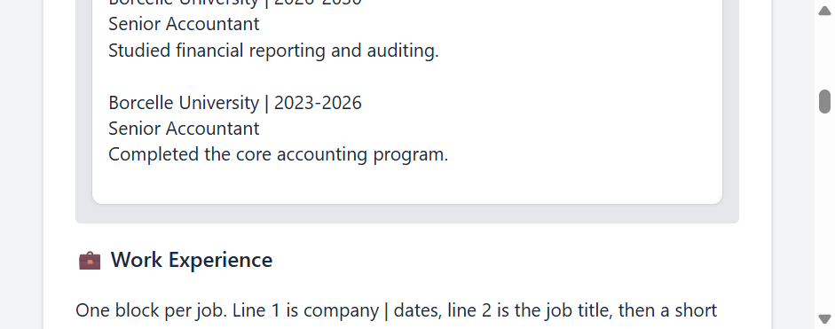
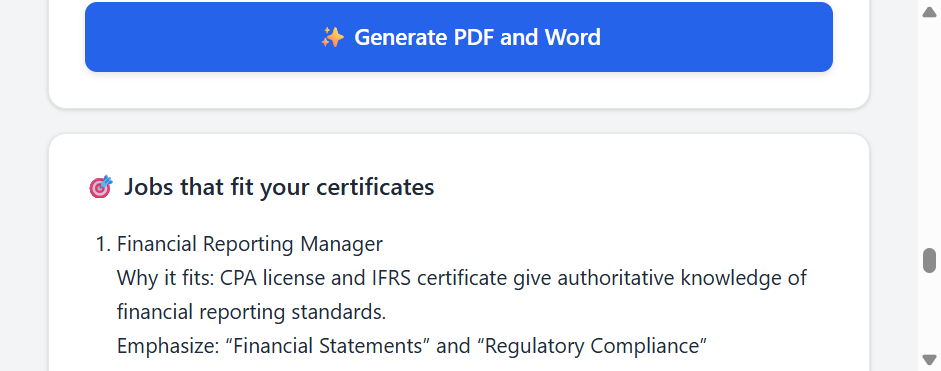
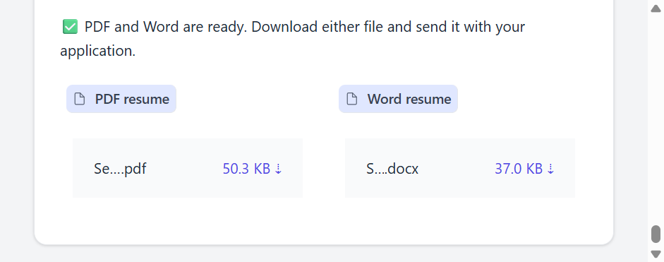
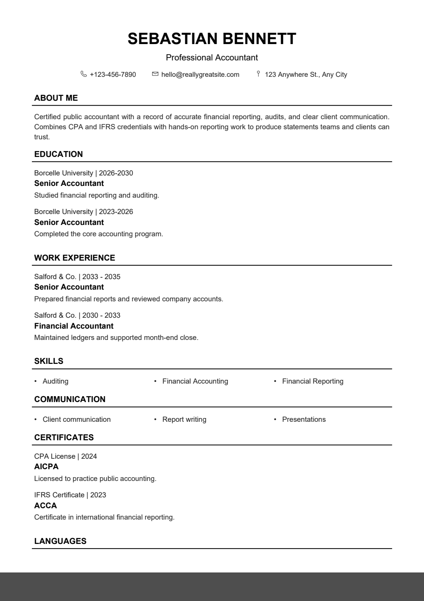

# Resume Architect

Resume Architect turns the details you type into a resume you can send with a job application. It writes a short professional summary, suggests roles that fit your certificates, and saves both a PDF and a Word file.

The screenshots use a fictional sample (Sebastian Bennett). Your own files are written to `data/` and are not part of this repository.

## Screenshots

The Education box sits under Personal Details. A blank Education box is left off the file, so fill it before you generate.



After you generate, the app lists jobs that match the certificates and skills, and tells you what to emphasize on the application. Those suggestions stay in the app. They are not printed on the resume.



Both files are ready to download.



The PDF keeps a simple one-column layout: name, contact, About Me, Education, Work Experience, Skills, Communication, Certificates, and Languages.



## What you can enter

| Section | How to write it |
| --- | --- |
| Education | One block per qualification. Line 1 is `School \| dates`, line 2 is the qualification, then a short description. Leave a blank line between blocks. |
| Work experience | Same pattern: `Company \| dates`, job title, then what you did. |
| Skills | Comma-separated, for example `Auditing, Financial Reporting`. |
| Communication | Comma-separated, for example `Report writing, Presentations`. |
| Certificates | One block per certificate: `Name \| year`, who issued it, then what it covers. |
| Languages | One per line, for example `English \| Native`. |
| Target job | Optional. Paste a job post to aim the summary and the job list at that role. |

## Setup

You need Python 3.10 or newer and a [Groq](https://console.groq.com) API key. The key is only used to write the summary and the job suggestions. The PDF and Word files are created on your machine.

```bash
python -m venv .venv
```

Windows:

```powershell
.venv\Scripts\Activate.ps1
pip install -r requirements.txt
copy .env.example .env
```

macOS and Linux:

```bash
source .venv/bin/activate
pip install -r requirements.txt
cp .env.example .env
```

Open `.env` and set `GROQ_API_KEY` to your own key. Do not commit that file.

Start the app:

```bash
python app.py
```

Then open http://127.0.0.1:7860

If the API key is missing, the app still builds the resume. The summary and job list fall back to plain text instead of a tailored result.

## Project layout

```
app.py                 starts the app
src/ui.py              the form
src/ai_writer.py       summary and job suggestions
src/pdf_builder.py     PDF resume
src/docx_builder.py    Word resume
docs/screenshots/      images used in this README
```

Generated resumes are saved in `data/`. That folder is ignored by git.

On Windows the PDF uses Arial. On other systems it falls back to Helvetica, so the contact icons may be omitted.
